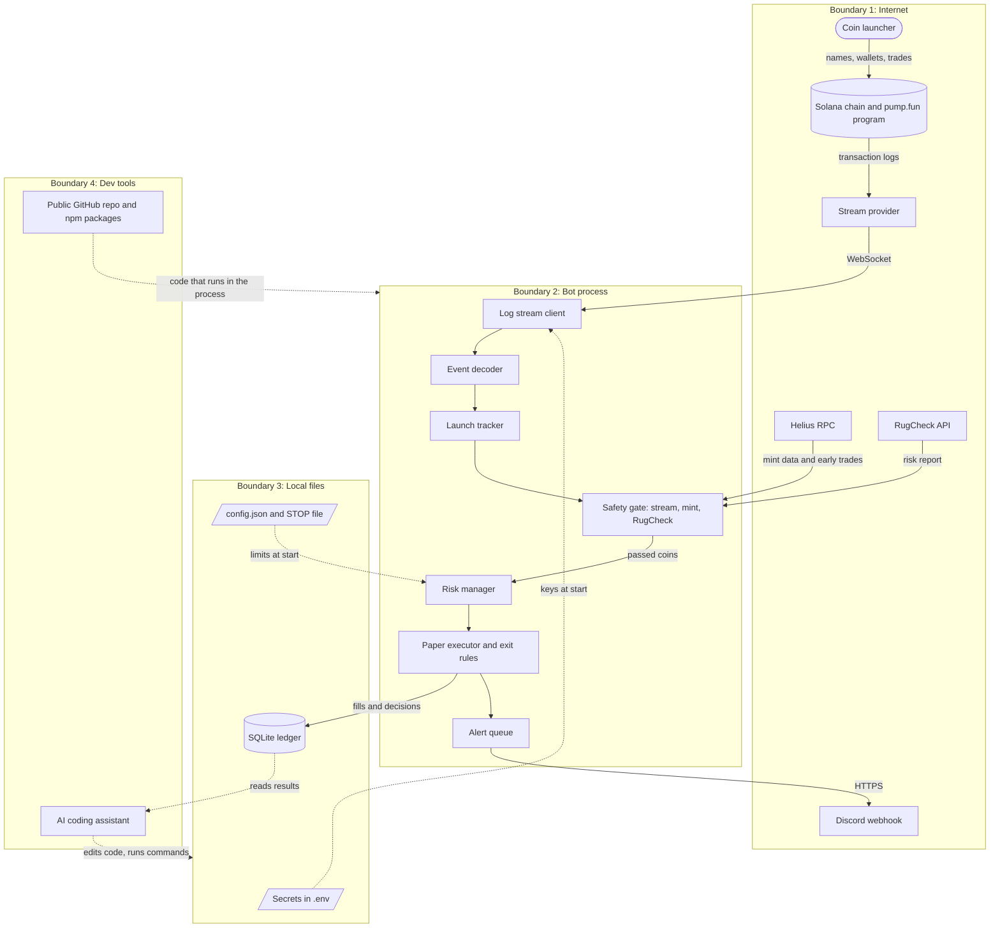
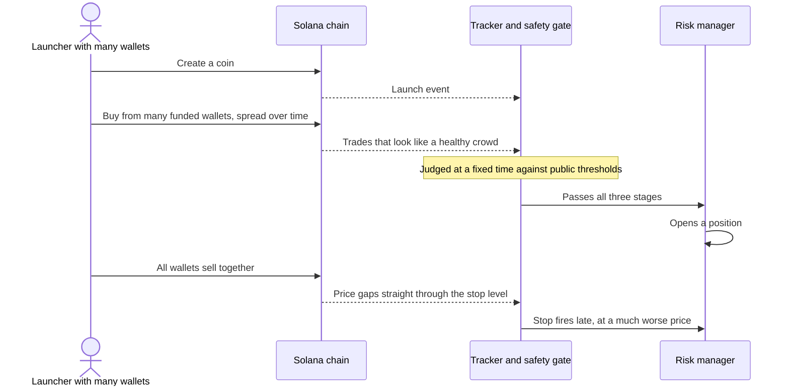
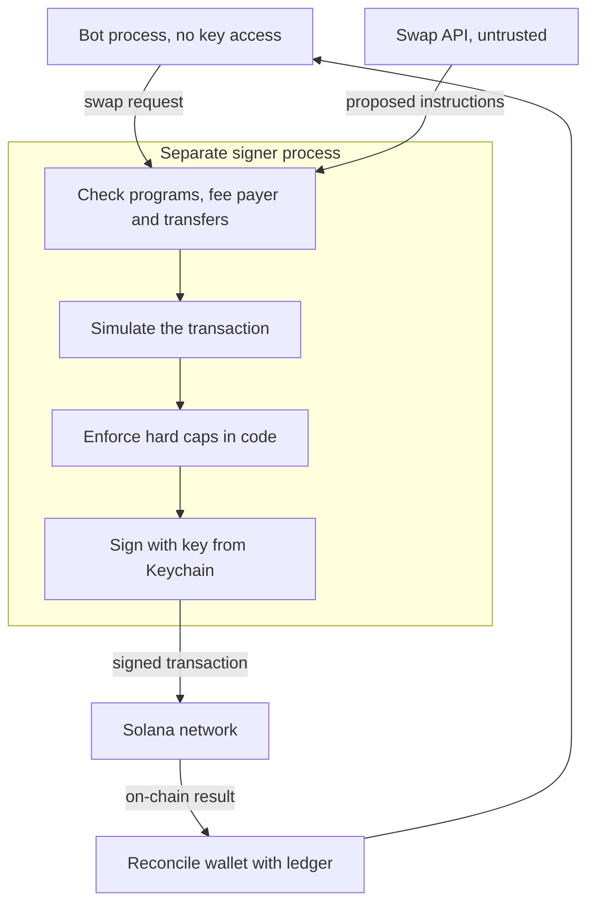

# Threat Model: The Watchman

A STRIDE threat model of [The Watchman](https://github.com/Iamendlesss/the-watchman), a paper-trading Solana bot written in TypeScript. It maps how data moves through the bot, where trust changes, what can go wrong, and what must exist before the bot could ever hold a real key.

| | |
|---|---|
| **System reviewed** | The Watchman v0.4.0, commit [`284b4f3`](https://github.com/Iamendlesss/the-watchman/tree/284b4f38ee10c6f90806b292a5811e50129d811d) |
| **Method** | STRIDE per component, rated for today (paper mode) and for a future live mode |
| **Evidence** | Source review, secret scan of git history, dependency audit, offline tests of gate logic with crafted input |
| **Date** | 3 November 2026 |
| **Result** | 26 threats (8 rated Critical if the bot went live, none rated above Medium today), 15 controls confirmed |

## Main findings

1. **Today's exposure is small, and that is by design.** Live mode is refused in code, no signing code or library exists, and the bot trades on paper. The realistic worst case today is stolen API keys or a compromised development machine, not lost funds.
2. **The gate measures wallets, not people.** A launcher running many wallets can look like a healthy crowd. This is the largest risk to the strategy and no threshold change fixes it.
3. **Some checks fail open.** One safety stage can pass a coin with no danger recorded when the outside service is unavailable or changes its response format. Live mode needs these checks to fail closed.
4. **The development environment is the shortest route to the secrets.** Package code and an AI coding assistant both run next to the `.env` file. CI and branch protection now guard what reaches `main`, but they cannot stop a tool on the operator's own machine.
5. **Going live has a clear bar.** [13 security gates](docs/live-readiness.md) must pass first, and all 8 Critical threats map to one of them.

## System and trust boundaries

Solid lines are runtime data. Dotted lines are setup or development paths. The bot runs on the operator's Mac, and everything on the internet side is untrusted. Every string that reaches the decoder is authentic chain data, yet its content is chosen by the launcher, so a valid transaction is still untrusted input.

## What needs protecting

| Asset | Why it matters |
|---|---|
| API keys and webhook URL | Stolen keys can be abused or run up usage |
| Decision integrity | The gate and risk rules decide every trade |
| Ledger accuracy | Paper results decide whether the bot goes live |
| Working exits | A stop that does not fire turns a small loss into a large one |
| Future trading key | Controls all funds in the live wallet |

## Who could attack it

| Actor | Can do | Cost to them |
|---|---|---|
| Coin launcher | Choose coin names, run many wallets, time trades | Very low |
| Package or tool supply chain | Run code on the operator's Mac | Medium |
| Data provider, or anyone between | Send false or missing data | High |
| Malware on the Mac | Read secrets, edit config and ledger | Medium |
| Public GitHub user | Open issues and pull requests that an assistant may read | Very low |
| The operator, by accident | Mistype a limit, start from the wrong folder | None |

## Top risks

The 8 threats rated Critical for live mode. Ratings show likelihood × impact before any planned control is built. The [full analysis](docs/stride-analysis.md) covers all 26.

| ID | Threat | STRIDE | Now | If live | Planned control |
|---|---|---|---|---|---|
| T-01 | Crafted launch: one operator looks like a crowd | S | Medium (3×1) | Critical (3×3) | Cluster wallets by funding source, track creator history |
| T-06 | Stale prices during a stream outage | D | Medium (3×1) | Critical (3×3) | Stale-price guard, second provider, outage policy |
| T-21 | Malicious or vulnerable packages | T, E | Medium (1×4) | Critical (2×4) | CI scanning that blocks merges, Dependabot |
| T-24 | Prompt injection into an AI coding assistant | E, I | Medium (1×4) | Critical (2×4) | Block secrets at tool-permission level, treat ledger text as data |
| T-18 | Plain-text secrets file | I | Medium (2×2) | Critical (2×4) | Keychain storage, permission check at every start |
| T-10 | Limits are settings, not hard caps | E, T | Low (1×1) | Critical (2×4) | Hard caps in code for live mode |
| T-19 | Trading key shared with every package | I, E | Low (1×1) | Critical (2×4) | Separate signer process |
| T-25 | Hostile instructions from the swap API | T, E | Not built | Critical (2×4) | Decode and verify every transaction before signing |

**Fix first, while it is cheap:** a security pipeline (T-21, T-22), fail-closed checks (T-03, T-04), and assistant containment (T-24). None of these need live mode to exist. The [security pipeline](https://github.com/Iamendlesss/the-watchman/blob/main/docs/security-pipeline.md) is now built.

## Attack walk-through: the crafted launch

Offline testing confirmed the gate logic accepts this pattern. The attack is not aimed at this bot in particular. It targets every buyer of a coin, so it applies to any strategy that trusts wallet counts.

## Controls confirmed in the code

Each link points to the reviewed commit.

| Control | Why it matters | Evidence |
|---|---|---|
| Live mode refused | A config change alone cannot start real trading | [`config.ts`](https://github.com/Iamendlesss/the-watchman/blob/284b4f38ee10c6f90806b292a5811e50129d811d/src/config.ts#L155-L163) |
| Executor has no network or key access | Simulated fills cannot spend funds | [`executor.ts`](https://github.com/Iamendlesss/the-watchman/blob/284b4f38ee10c6f90806b292a5811e50129d811d/src/executor.ts#L33-L39) |
| No signing library installed | There is no code path that can sign | [`package.json`](https://github.com/Iamendlesss/the-watchman/blob/284b4f38ee10c6f90806b292a5811e50129d811d/package.json) |
| One path to a new position | Risk rules cannot be skipped | [`engine.ts`](https://github.com/Iamendlesss/the-watchman/blob/284b4f38ee10c6f90806b292a5811e50129d811d/src/engine.ts#L68-L72) |
| Drawdown floor checked on every tick | Halts arrive as soon as equity crosses the floor | [`paper.ts`](https://github.com/Iamendlesss/the-watchman/blob/284b4f38ee10c6f90806b292a5811e50129d811d/src/paper.ts#L121-L135) |
| Mint check fails closed | An unreadable account blocks the coin | [`mintCheck.ts`](https://github.com/Iamendlesss/the-watchman/blob/284b4f38ee10c6f90806b292a5811e50129d811d/src/safety/mintCheck.ts#L65-L69) |
| Events accepted only from the pump.fun program | Data logged by other programs in the same transaction is ignored | [`events.ts`](https://github.com/Iamendlesss/the-watchman/blob/284b4f38ee10c6f90806b292a5811e50129d811d/src/scanner/events.ts#L100-L117) |
| Length limits on decoded data | Malformed input is rejected instead of forcing large allocations | [`borsh.ts`](https://github.com/Iamendlesss/the-watchman/blob/284b4f38ee10c6f90806b292a5811e50129d811d/src/scanner/borsh.ts#L91-L95) |
| Discord host allowlist | A typo cannot send alerts or the webhook path elsewhere | [`discord.ts`](https://github.com/Iamendlesss/the-watchman/blob/284b4f38ee10c6f90806b292a5811e50129d811d/src/alerts/discord.ts#L6-L17) |
| Coin names cleaned, mentions off | Names cannot ping people or add links in Discord | [`discord.ts`](https://github.com/Iamendlesss/the-watchman/blob/284b4f38ee10c6f90806b292a5811e50129d811d/src/alerts/discord.ts#L19-L27) |
| Parameterized SQL | No SQL built from coin data, confirmed by search | [`ledger.ts`](https://github.com/Iamendlesss/the-watchman/blob/284b4f38ee10c6f90806b292a5811e50129d811d/src/ledger.ts#L157-L168) |
| Secret values never printed | Keys stay out of logs and error text | [`cli.ts`](https://github.com/Iamendlesss/the-watchman/blob/284b4f38ee10c6f90806b292a5811e50129d811d/src/cli.ts#L29), [`ws.ts`](https://github.com/Iamendlesss/the-watchman/blob/284b4f38ee10c6f90806b292a5811e50129d811d/src/scanner/ws.ts#L6) |
| API usage budget | A data flood cannot run up usage without limit | [`scan.ts`](https://github.com/Iamendlesss/the-watchman/blob/284b4f38ee10c6f90806b292a5811e50129d811d/src/scan.ts#L290-L299) |
| Pinned dependencies | Direct versions are exact, and all 120 locked packages resolve to the npm registry | [`package-lock.json`](https://github.com/Iamendlesss/the-watchman/blob/284b4f38ee10c6f90806b292a5811e50129d811d/package-lock.json) |
| Secret protection on the repo | GitHub secret scanning and push protection are on, and a pattern scan of git history found no real secrets | GitHub API and history scan on the review date |

## Before the bot could go live

The planned design moves the key out of the bot and treats the swap API as untrusted. The [live-readiness checklist](docs/live-readiness.md) lists every gate.

## In this repository

| File | Contents |
|---|---|
| [docs/stride-analysis.md](docs/stride-analysis.md) | All 26 threats, by component |
| [docs/live-readiness.md](docs/live-readiness.md) | The 13 gates that must pass before live mode |
| [docs/method.md](docs/method.md) | Scope, rating scale, evidence and limits of this review |

Exact code locations and reproduction steps for open threats are kept private until each one is fixed. Risks are described here at design level, and code links appear only for controls that already work.
